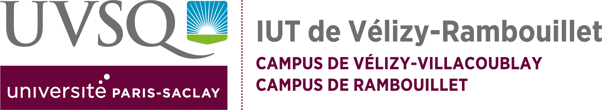

  

  <h1>🎓 IUT de Vélizy-Rambouillet — UVSQ</h1>
  
<strong>Plateforme de développement des applications et outils internes de l'IUT</strong>

  <!-- Badges d'information et liens rapides -->
  

    
    
    
  

---

### 👋 À propos de cette organisation

Bienvenue sur l'espace GitHub officiel de l'**IUT de Vélizy-Rambouillet** (composante de l'*Université de Versailles Saint-Quentin-en-Yvelines* — *Université Paris-Saclay*).

Cette organisation centralise le code source des applications pédagogiques, administratives et techniques développées en interne par le personnel, les enseignants et les étudiants (projets tutorés, SAÉ, stages et outils des services techniques).

---

### 🚀 Nos projets principaux

| Projet | Description | Technologies | Statut | Accès |
| :--- | :--- | :--- | :---: | :---: |
| **[edtpp](https://github.com/IUT-Velizy-Rambouillet/edtpp)** | **EDT++** — Panneau d'affichage dynamique (emplois du temps et informations sur les écrans) |    | 🟢 Actif | 🔒 Interne |
| **[vertex](https://github.com/IUT-Velizy-Rambouillet/vertex)** | **Vertex** — Gestion du réseau des salles (bascule des VLAN, mode examen) |    | 🟢 Actif | 🔒 Interne |
| **[bifrost](https://github.com/IUT-Velizy-Rambouillet/bifrost)** | **Bifrost** — Plateforme de dépôt de travaux (rendus, examens) |   | 🟢 Actif | 🔒 Interne |
| **[heimdall](https://github.com/IUT-Velizy-Rambouillet/heimdall)** | **Heimdall** — Signalement et suivi des pannes en salle (QR code par salle, tickets) |    | 🟢 Actif | 🔒 Interne |
| **[horae](https://github.com/IUT-Velizy-Rambouillet/horae)** | **Horae** — _description à venir_ |   | 🟢 Actif | 🔒 Interne |

---

### 🏛️ Campus & Départements de l'IUT

Nos outils accompagnent le quotidien des équipes et des étudiants répartis sur nos deux sites :

* 📍 **Site de Vélizy-Villacoublay :**
  * 💻 **INFO** — Informatique
  * 🎨 **MMI** — Métiers du Multimédia et de l'Internet
  * ⚡ **GEII** — Génie Électrique et Informatique Industrielle
  * 🌐 **R&T** — Réseaux et Télécommunications
* 📍 **Site de Rambouillet :**
  * 💼 **GEA** — Gestion des Entreprises et des Administrations
  * 🤝 **TC** — Techniques de Commercialisation
  * 🧪 **GCGP** — Génie Chimique - Génie des Procédés

---

### 🛠️ Technologies & Standards utilisés

  
  
  
  
  
  
  
  
  
  
  
  

---

### 📌 Guide pour les membres (Étudiants, Enseignants & BIATSS)

#### 1. Accès aux dépôts privés
Si vous ne voyez pas les dépôts de votre projet sur la page d'accueil :
* Vérifiez que vous êtes bien connecté au compte GitHub ayant reçu l'invitation de l'organisation.
* En haut à droite de la page d'accueil de l'organisation, basculez l'affichage de **`View as: Public`** vers **`View as: Member`**.

#### 2. Flux de travail (Workflow Git)
Pour garantir la stabilité des applications en production (notamment sur les écrans et serveurs de l'IUT), merci de respecter ces règles :
1. **Branche principale protégée :** Ne poussez jamais directement sur la branche `main` (ou `master`).
2. **Branches de travail :** Créez une branche dédiée pour chaque évolution ou correction :
   * `feature/nom-de-la-fonctionnalite` (ex: `feature/meteo-panneau`)
   * `fix/nom-du-bug` (ex: `fix/affichage-horaires`)
3. **Pull Requests (PR) :** Une fois votre code testé localement, ouvrez une *Pull Request* vers `main` et demandez une relecture avant la fusion (*merge*).

#### 3. Convention de commits
Privilégiez des messages de commit clairs et préfixés :
* `feat:` ajout d'une nouvelle fonctionnalité
* `fix:` correction d'un bug
* `style:` modifications visuelles (CSS, mise en page)
* `docs:` mise à jour de la documentation (`README`, commentaires)

#### 4. Sécurité & Confidentialité 🔒
* **Aucun secret dans le code :** Ne commitez **jamais** de mots de passe, clés d'API, certificats ou identifiants de base de données.
* Utilisez systématiquement un fichier `.env` ignoré par Git (via `.gitignore`) et fournissez uniquement un fichier `.env.example` contenant des valeurs fictives.
* Une faille trouvée dans une application ? Signalez-la en privé aux administrateurs de l'organisation, jamais dans une *issue* publique.

---

  📍 <b>IUT de Vélizy-Rambouillet</b> — 10-12 avenue de l'Europe, 78140 Vélizy-Villacoublay | 19 allée des Vignes, 78120 Rambouillet

